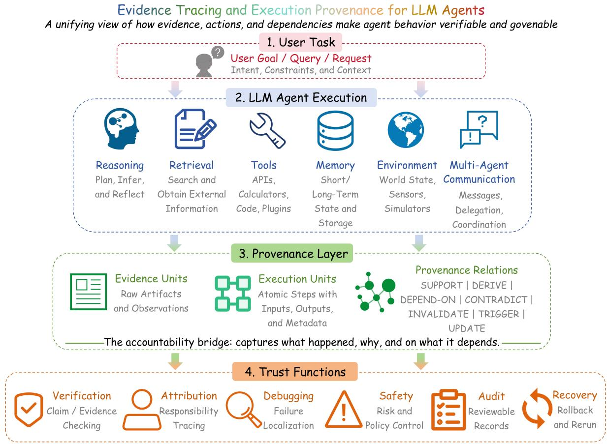
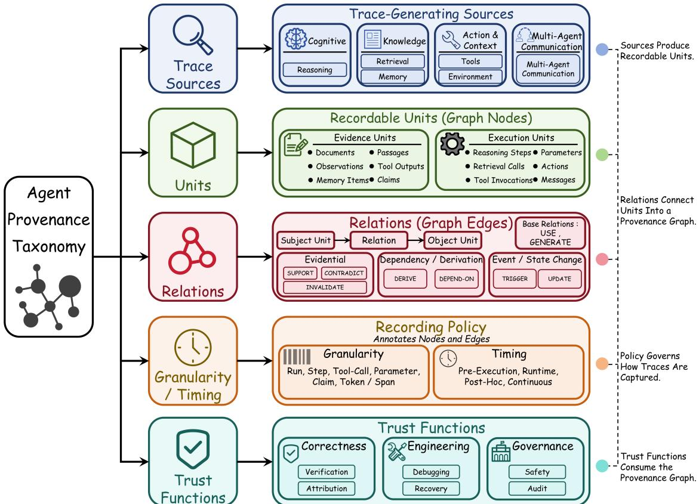
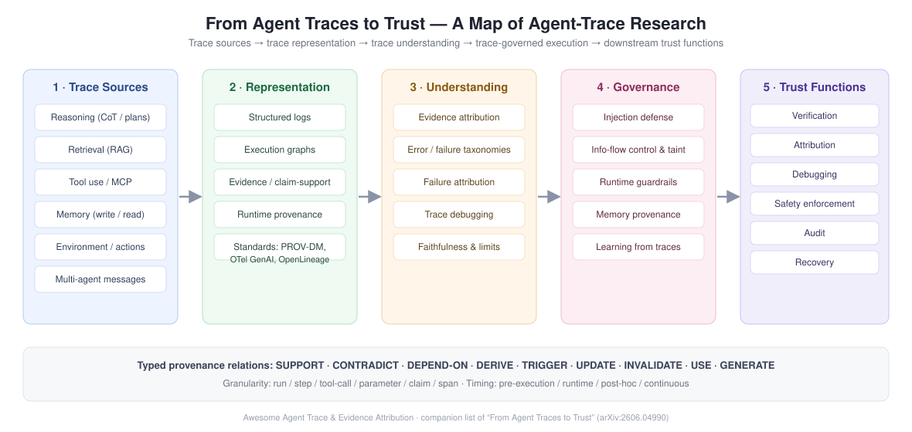

# Awesome Agent Trace

[](https://awesome.re)
[](https://arxiv.org/abs/2606.04990)
[](https://opensource.org/licenses/MIT)
[](http://makeapullrequest.com)

**Agents are judged by their final answers — but trust lives in the trace.** Which evidence supported each claim? Where did a tool argument come from? Which step, agent, or memory item caused the failure? This list maps research that records, represents, attributes, enforces, debugs, and learns from **LLM-agent traces**.

**30+ taxonomies & attribution methods | 20+ safety & memory-provenance papers | 25+ benchmarks & datasets | 15+ observability tools & standards | Continuously updated**

This repository accompanies the survey:

> **From Agent Traces to Trust: A Survey of Evidence Tracing and Execution Provenance in LLM Agents**
>
> Yiqi Wang, Jiaqi Zhang, Zhangkai Wu, Taotao Cai, Zirui Liu, Qingqiang Sun, Zequn Sun, Manqing Dong, Mingkai Zheng, Xuefei Yin, Yanming Zhu
>
> [[Paper]](https://arxiv.org/abs/2606.04990)

---

## Contents

- [Why Agent Traces?](#why-agent-traces)
- [Surveys & Overviews](#surveys--overviews)
- [Foundations: Standards, Schemas & Provenance Models](#foundations-standards-schemas--provenance-models)
  - [Agent Substrates (Trace Sources)](#agent-substrates-trace-sources)
- [Observability Platforms & Trace Tooling](#observability-platforms--trace-tooling)
- [Evidence Attribution & Grounding](#evidence-attribution--grounding)
- [Error & Failure Taxonomies](#error--failure-taxonomies)
- [Failure Attribution & Trace Debugging](#failure-attribution--trace-debugging)
  - [Multi-Agent Failure Attribution](#multi-agent-failure-attribution)
  - [Single-Agent, Span-Level and Domain Diagnosis](#single-agent-span-level-and-domain-diagnosis)
  - [Trace-Driven Repair & Recovery](#trace-driven-repair--recovery)
- [Runtime Provenance, Injection Defense & Guardrails](#runtime-provenance-injection-defense--guardrails)
  - [Indirect Prompt Injection & Tool Contamination](#indirect-prompt-injection--tool-contamination)
  - [Instruction-Data Separation & Information-Flow Control](#instruction-data-separation--information-flow-control)
  - [Execution Boundaries & Guardrails](#execution-boundaries--guardrails)
  - [Classical Security Foundations](#classical-security-foundations)
- [Memory Provenance, Poisoning & Long-Term Audit](#memory-provenance-poisoning--long-term-audit)
- [Learning from Traces: Experience, Skills, Rewards & Credit](#learning-from-traces-experience-skills-rewards--credit)
- [Faithfulness Debate: What Do Traces Actually Tell Us?](#faithfulness-debate-what-do-traces-actually-tell-us)
- [Benchmarks & Datasets](#benchmarks--datasets)
- [Related Awesome Lists](#related-awesome-lists)
- [Contributing](#contributing)
- [Citation](#citation)
- [License](#license)

---

## Why Agent Traces?

LLM agents plan, retrieve, call tools, write memory, act in environments, and talk to each other — yet they are still evaluated almost entirely by final answers. A correct answer reveals nothing about *how* the output was produced, and a failed run gives no pointer to *which* step decided the outcome. Agent traces (recorded artifacts of an agent run: instructions, retrievals, tool calls and outputs, memory operations, observations, intermediate claims, inter-agent messages, actions) are the substrate for closing this **process-level accountability gap**.

Two lenses organize the field:

- **Execution provenance** — the full typed graph of an agent execution: evidence units, execution units, and relations such as `SUPPORT`, `CONTRADICT`, `DEPEND-ON`, `DERIVE`, `TRIGGER`, `UPDATE`, `INVALIDATE`.
- **Evidence tracing** — the projection of that graph onto evidence-support relations: which evidence backs which claim, decision, or action.

<p align="center">
  
</p>
<p align="center"><sub>Framework overview: a heterogeneous agent execution (reasoning, retrieval, tools, memory, environment, multi-agent) is recorded as a provenance layer of typed evidence/execution units and relations, which feeds downstream trust functions — verification, attribution, debugging, safety, audit, and recovery. (Figure from the <a href="https://arxiv.org/abs/2606.04990">companion survey</a>.)</sub></p>

<p align="center">
  
</p>
<p align="center"><sub>The six-dimension taxonomy of agent provenance: trace sources, evidence and execution units, provenance relations, tracing granularity and timing, representation forms, and trust functions. (Figure from the <a href="https://arxiv.org/abs/2606.04990">companion survey</a>.)</sub></p>

<p align="center">
  
</p>
<p align="center"><sub>How this awesome list maps onto the pipeline: <b>trace sources → trace representation → trace understanding (attribution, diagnosis, debugging) → trace-governed execution (safety, memory, learning) → trust functions (verification, audit, recovery)</b>.</sub></p>

---

## Surveys & Overviews

1. **From Agent Traces to Trust: A Survey of Evidence Tracing and Execution Provenance in LLM Agents** (2026)

   *Yiqi Wang, Jiaqi Zhang, Zhangkai Wu, Taotao Cai, Zirui Liu, Qingqiang Sun, Zequn Sun, Manqing Dong, Mingkai Zheng, Xuefei Yin, Yanming Zhu*

   [[Paper]](https://arxiv.org/abs/2606.04990) -- The companion survey of this list: a six-dimension taxonomy (trace sources, evidence/execution units, relations, granularity & timing, representation, trust functions) and seven research threads from provenance representation to failure diagnosis.

2. **A Survey for LLM Agent Trajectory Analysis: From Failure Attribution to Enhancement** (TSE 2026)

   *Junjie Wang, Mengzhuo Chen, et al.*

   [[Paper]](https://www.computer.org/csdl/journal/ts/5555/01/11626967/2iuF5rxPMqs) [[GitHub]](https://github.com/IcyFeather233/Awesome-LLM-Agent-Trajectory-Analysis) -- Systematic review of trajectory analysis: failure taxonomy, attribution, system enhancement, monitoring tools, and datasets; ships a 4,316-trajectory annotated dataset.

3. **Survey on Evaluation of LLM-based Agents** (ACL 2025 Findings)

   *Bing Wang, Xinyi Dai, et al.*

   [[Paper]](https://arxiv.org/abs/2503.16416) -- Broad evaluation landscape for LLM agents, including process- and trajectory-level evaluation perspectives.

4. **Attribution, Citation, and Quotation: A Survey of Evidence-Based Text Generation with LLMs** (2025)

   *Tobias Schreieder, Tim Schopf, Michael Färber*

   [[Paper]](https://arxiv.org/abs/2508.15396) -- Survey of evidence-based generation: attribution, citation, and quotation across the grounding literature.

5. **From Reasoning to Agentic: Credit Assignment in Reinforcement Learning for LLMs** (2026)

   *Chenchen Zhang*

   [[Paper]](https://arxiv.org/abs/2604.09459) [[GitHub]](https://github.com/xxzcc/Awesome-Credit-Assignment-in-LLM-RL) -- 47-method survey of credit assignment across token/step/turn/multi-agent granularities; the training-side mirror of failure attribution.

6. **A Survey of Process Reward Models** (2025)

   *Fei Du, et al.*

   [[Paper]](https://arxiv.org/abs/2510.08049) -- Step-level reward models that judge trajectory prefixes, from math reasoning to agentic tasks.

7. **A Survey on the Memory Mechanism of Large Language Model Based Agents** (ACM TOIS 2025)

   *Zeyu Zhang, Xiaohe Bo, Chen Ma, Rui Li, Xu Chen, Quanyu Dai, Jieming Zhu, Zhenhua Dong, Ji-Rong Wen*

   [[Paper]](https://dl.acm.org/doi/10.1145/3748302) -- What agents store, how memories are written/read/updated — the substrate memory provenance builds on.

8. **Memory for Autonomous LLM Agents: Mechanisms, Evaluation, and Emerging Frontiers** (2026)

   *Pengfei Du*

   [[Paper]](https://arxiv.org/abs/2603.07670) -- Mechanisms and evaluation protocols for agent memory.

9. **Graph-Based Agent Memory: Taxonomy, Techniques, and Applications** (2026)

   *Chang Yang, Chuang Zhou, et al.*

   [[Paper]](https://arxiv.org/abs/2602.05665) -- Relational/graph memory systems for agents.

---

## Foundations: Standards, Schemas & Provenance Models

10. **W3C PROV-DM: The PROV Data Model** (W3C Recommendation, 2013)

    [[Spec]](https://www.w3.org/TR/prov-dm/) -- Entities, activities, agents and derivation/usage/invalidation relations — the base vocabulary agent provenance extends with `SUPPORT`/`CONTRADICT` and trust labels.

11. **OpenTelemetry — GenAI & Agents Semantic Conventions** (2026)

    [[Spec]](https://opentelemetry.io/docs/specs/semconv/gen-ai/) -- Spans for LLM calls, tool invocations, and agent execution; the de-facto runtime trace interchange for agent observability stacks.

12. **OpenLineage Specification** (2026)

    [[Spec]](https://github.com/OpenLineage/OpenLineage/blob/main/spec/OpenLineage.md) -- Lineage standard for data workflows; a reference point for cross-system agent provenance.

13. **PROV-AGENT: Unified Provenance for Tracking AI Agent Interactions in Agentic Workflows** (IEEE eScience 2025)

    *Renan Souza, Amal Gueroudji, Stephen DeWitt, et al.*

    IEEE eScience 2025 -- Adapts PROV modeling to agentic workflows: prompts, decisions, tool interactions, and workflow context.

14. **AgentTrace: A Structured Logging Framework for Agent System Observability** (2026)

    *Adam AlSayyad, Kelvin Yuxiang Huang, Richik Pal*

    [[Paper]](https://arxiv.org/abs/2602.10133) -- Organizes execution records into operational, cognitive, and contextual logs.

15. **AgentOps: Enabling Observability of LLM Agents** (2024)

    *Liming Dong, Qinghua Lu, Liming Zhu*

    [[Paper]](https://arxiv.org/abs/2411.05285) [[Code]](https://github.com/AgentOps-AI/agentops) -- Observability architecture that records agent artifacts and their lifecycle relationships.

16. **OpenInference** (Arize AI)

    [[Spec]](https://github.com/Arize-ai/openinference) -- Open instrumentation convention for LLM/agent tracing, natively emitted through OpenTelemetry.

### Agent Substrates (Trace Sources)

17. **ReAct: Synergizing Reasoning and Acting in Language Models** (ICLR 2023)

    *Shunyu Yao, Jeffrey Zhao, Dian Yu, et al.*

    [[Paper]](https://arxiv.org/abs/2210.03629) -- The reasoning–action loop whose thought/action/observation records became the canonical agent trace format.

18. **Toolformer: Language Models Can Teach Themselves to Use Tools** (NeurIPS 2023)

    *Timo Schick, Jane Dwivedi-Yu, Roberto Dessì, et al.*

    [[Paper]](https://arxiv.org/abs/2302.04761) -- Self-supervised API-call insertion; the earliest tool-call trace construction at scale.

19. **ToolLLM: Facilitating Large Language Models to Master 16000+ Real-world APIs** (ICLR 2024)

    *Yujia Qin, Shihao Liang, Yining Ye, et al.*

    [[Paper]](https://arxiv.org/abs/2307.16789) [[Code]](https://github.com/OpenBMB/ToolBench) -- ToolBench trajectories: API-call paths with arguments, outputs, and failures.

20. **AutoGen: Enabling Next-Gen LLM Applications via Multi-Agent Conversation** (COLM 2024)

    *Qingyun Wu, Gagan Bansal, Jieyu Zhang, et al.*

    [[Paper]](https://arxiv.org/abs/2308.08155) [[Code]](https://github.com/microsoft/autogen) -- Multi-agent conversation framework; message logs as a trace source.

21. **CAMEL: Communicative Agents for "Mind" Exploration of Large Language Model Society** (NeurIPS 2023)

    *Guohao Li, Hasan Hammoud, Hani Itani, Dmitrii Khizbullin, Bernard Ghanem*

    [[Paper]](https://arxiv.org/abs/2303.17760) [[Code]](https://github.com/camel-ai/camel) -- Role-playing multi-agent trajectories via inception prompting.

22. **Model Context Protocol (MCP)** (Anthropic, 2024)

    [[Spec]](https://github.com/modelcontextprotocol/modelcontextprotocol) -- Standardized tool/server interface that defines the execution boundary MCP-safety and tool-provenance work targets.

---

## Observability Platforms & Trace Tooling

### Open-Source Platforms

23. **Langfuse** — open-source LLM engineering platform; OpenTelemetry-native traces, prompt management, evaluations, and agent session replay. [[GitHub]](https://github.com/langfuse/langfuse)

24. **Arize Phoenix** — LLM/agent tracing, evals, and experimentation built on OpenInference; datasets + playground for trace-level debugging. [[GitHub]](https://github.com/Arize-ai/phoenix)

25. **AgentOps (SDK)** — drop-in agent observability SDK: session recording, tool-call timelines, replay, and failure analytics. [[GitHub]](https://github.com/AgentOps-AI/agentops)

26. **MLflow Tracing** — GenAI/agent tracing in MLflow (OpenAI/LangGraph autologging), trace-level evaluation. [[GitHub]](https://github.com/mlflow/mlflow) [[Docs]](https://mlflow.org/docs/latest/llms/tracing/)

27. **W&B Weave** — trace, evaluate, and iterate on LLM apps and agents inside Weights & Biases. [[GitHub]](https://github.com/wandb/weave)

28. **OpenLIT** — OpenTelemetry-native LLM & agent monitoring (metrics + traces) in a single binary. [[GitHub]](https://github.com/openlit/openlit)

29. **OpenLLMetry (Traceloop)** — OTel SDKs instrumenting LLM providers, vector DBs, and agent frameworks. [[GitHub]](https://github.com/traceloop/openllmetry)

30. **LangSmith & LangGraph** — commercial tracing/eval platform; LangGraph persists step-level graph state with checkpointing and time-travel replay. [[Website]](https://www.langchain.com/langsmith) [[Code]](https://github.com/langchain-ai/langgraph)

31. **Helicone** — open-source LLM proxy for logging, caching, and observability. [[GitHub]](https://github.com/Helicone/helicone)

### Research Tooling & Debuggers

32. **AgentDebugX: An Open-Source Toolkit for Failure Observability, Attribution, and Recovery in LLM Agents** (2026)

    [[Paper]](https://arxiv.org/abs/2607.18754) -- Unified event representation (on OTel GenAI spans) with a 19-pattern seed vocabulary; observability → attribution → recovery loop in one toolkit.

33. **MAESTRO: Multi-Agent Evaluation Suite for Testing, Reliability, and Observability** (2026)

    [[Paper]](https://arxiv.org/abs/2601.00481) [[Code]](https://github.com/sands-lab/maestro) -- Testing/reliability/observability suite for multi-agent systems.

34. **Signals: Trajectory Sampling and Triage for Agentic Interactions** (2026)

    [[Paper]](https://arxiv.org/abs/2604.00356) -- Sampling and triage of agent trajectories for human review.

35. **DiLLS: Interactive Diagnosis of LLM-based Multi-Agent Systems via Layered Summary of Agent Behaviors** (CHI 2026)

    [[Paper]](https://arxiv.org/abs/2602.05446) -- Layered behavioral summaries for interactive MAS diagnosis.

36. **XAgen: An Explainability Tool for Identifying and Correcting Failures in Multi-Agent Workflows** (CHI 2025)

    [[Paper]](https://arxiv.org/abs/2512.17896) -- Human-in-the-loop explainability and correction for multi-agent failures.

37. **LADYBUG: An LLM Agent Debugger for Data-Driven Applications** (EDBT 2025)

    *Joel Rorseth, Parke Godfrey, Lukasz Golab, Divesh Srivastava, Jarek Szlichta*

    [[Paper]](https://openproceedings.org/2025/conf/edbt/paper-313.pdf) -- Trace-based debugging to support failure localization and repair.

38. **Trajectory Guard: A Lightweight, Sequence-Aware Model for Real-Time Anomaly Detection in Agentic AI** (AAAI Workshop 2026)

    [[Paper]](https://arxiv.org/abs/2601.00516) -- Real-time trajectory anomaly detection over streaming agent actions.

39. **Taming Uncertainty via Automation: Observing, Analyzing, and Optimizing Agentic AI Systems** (2025)

    [[Paper]](https://arxiv.org/abs/2507.11277) -- End-to-end observe–analyze–optimize loop over agent execution.

40. **AgentEval: DAG-Structured Step-Level Evaluation for Agentic Workflows with Error Propagation Tracking** (2026)

    [[Paper]](https://arxiv.org/abs/2604.23581) -- DAG evaluation structure that tracks how errors propagate across workflow steps.

41. **ProMAS: Proactive Error Forecasting for Multi-Agent Systems Using Markov Transition Dynamics** (2026)

    [[Paper]](https://arxiv.org/abs/2603.20260) -- Forecasting errors before they surface from transition dynamics over trace states.

---

## Evidence Attribution & Grounding

42. **FEVER: A Large-Scale Dataset for Fact Extraction and Verification** (NAACL 2018)

    *James Thorne, Andreas Vlachos, Christos Christodoulopoulos, Arpit Mittal*

    [[Paper]](https://aclanthology.org/N18-1074/) -- The foundational claim-evidence support/REFUTES/NEI annotation scheme.

43. **Enabling Large Language Models to Generate Text with Citations (ALCE)** (EMNLP 2023)

    *Tianyu Gao, Howard Yen, Jiatong Yu, Danqi Chen*

    [[Paper]](https://arxiv.org/abs/2305.14627) [[Code]](https://github.com/princeton-nlp/ALCE) -- Citation generation and citation-quality evaluation for long-form outputs.

44. **FActScore: Fine-Grained Atomic Evaluation of Factual Precision in Long Form Text Generation** (EMNLP 2023)

    *Sewon Min, Kalpesh Krishna, Xinxi Lyu, et al.*

    [[Paper]](https://arxiv.org/abs/2305.14251) -- Decomposes outputs into atomic facts and scores support — claim-level granularity for tracing.

45. **How Well Do LLMs Cite Relevant Medical References? (SourceCheckup)** (2024)

    *Kevin Wu, Eric Wu, Ally Cassasola, et al.*

    [[Paper]](https://arxiv.org/abs/2402.02008) -- Shows a cited source can be *relevant without supporting* the claim — the citation ≠ support distinction.

46. **RAGTruth: A Hallucination Corpus for Developing Trustworthy Retrieval-Augmented Language Models** (ACL 2024)

    *Cheng Niu, Yuanhao Wu, Juno Zhu, et al.*

    [[Paper]](https://arxiv.org/abs/2401.00396) -- Word/span-level hallucination labels over RAG outputs.

47. **RAGChecker: A Fine-Grained Framework for Diagnosing Retrieval-Augmented Generation** (NeurIPS 2024)

    *Dongyu Ru, Lin Qiu, Xiangkun Hu, et al.*

    [[Paper]](https://arxiv.org/abs/2408.08067) [[Code]](https://github.com/amazon-science/RAGChecker) -- Claim-level claim–evidence graph diagnostics separating retriever vs. generator failures.

48. **RAGAS: Automated Evaluation of Retrieval Augmented Generation** (EACL 2024 Demo)

    *Shahul Es, Jithin James, Luis Espinosa Anke, Steven Schockaert*

    [[Paper]](https://aclanthology.org/2024.eacl-demo.16/) [[Code]](https://github.com/explodinggradients/ragas) -- Faithfulness / context-relevance / answer-relevance metrics, widely used for grounding checks.

49. **ARES: An Automated Evaluation Framework for Retrieval-Augmented Generation Systems** (NAACL 2024)

    *Jon Saad-Falcon, Omar Khattab, Christopher Potts, Matei Zaharia*

    [[Paper]](https://arxiv.org/abs/2311.09476) [[Code]](https://github.com/stanford-futuredata/ares) -- LLM-judge + confidence-interval evaluation for context relevance and faithfulness.

50. **PaperTrail: A Claim-Evidence Interface for Grounding Provenance in LLM-based Scholarly Q&A** (CHI 2026)

    *Anna Martin-Boyle, Cara Leckey, Martha Brown, Harmanpreet Kaur*

     CHI 2026 -- Decomposes answers and sources into discrete claims and evidence units — supported, unsupported, and omitted evidence made inspectable.

---

## Error & Failure Taxonomies

51. **Why Do Multi-Agent LLM Systems Fail? (MAST)** (2025)

    *Mert Cemri, Melissa Z. Pan, Shuyi Yang, et al.*

    [[Paper]](https://arxiv.org/abs/2503.13657) [[Code]](https://github.com/multi-agent-systems-failure-taxonomy/MAST) -- 14 failure modes in 3 categories derived from 150 annotated traces (inter-annotator agreement κ = 0.88); failures are systematic, not random.

52. **Where LLM Agents Fail and How They Can Learn From Failures (AgentDebug / AgentErrorTaxonomy)** (2025)

    [[Paper]](https://arxiv.org/abs/2509.25370) [[Code]](https://github.com/ulab-uiuc/AgentDebug) -- 17 error types across memory/reflection/planning/action/system modules; ships AgentErrorBench (200 failures). Note: withdrawn from ICLR 2026 by the authors.

53. **Failure Modes in LLM Systems: A System-Level Taxonomy for Reliable AI Applications** (2025)

    [[Paper]](https://arxiv.org/abs/2511.19933) -- 15 "hidden" failure modes beyond the model itself: harness, tools, and infrastructure included.

54. **Model or Harness? An Interaction-Centric Taxonomy for Localizing Agent Failures** (2026)

    *Raj et al.*

    [[Paper]](https://arxiv.org/abs/2607.28802) -- 41 patterns on a 6-component interaction graph, each labeled model-side vs. surrounding-stack-side — result labels alone cannot assign the fix.

55. **Aegis: Taxonomy and Optimizations for Overcoming Agent-Environment Failures in LLM Agents** (2025)

    [[Paper]](https://arxiv.org/abs/2508.19504) -- Error taxonomy for agent–environment mismatch plus workflow optimizations.

56. **How Do LLMs Fail in Agentic Scenarios? A Qualitative Analysis of Success and Failure Scenarios** (NeurIPS 2025)

    [[Paper]](https://arxiv.org/abs/2512.07497) -- Qualitative success/failure analysis of LLMs in agentic simulations.

57. **Exploring Autonomous Agents: A Closer Look at Why They Fail When Completing Tasks** (ASE 2025)

    [[Paper]](https://arxiv.org/abs/2508.13143) -- Empirical failure study of autonomous agents on real tasks.

58. **Demystifying the Lifecycle of Failures in Platform-Orchestrated Agentic Workflows** (2025)

    [[Paper]](https://arxiv.org/abs/2509.23735) -- 307 trajectories annotated over the full failure lifecycle, with repair strategies.

59. **Understanding Software Engineering Agents: A Study of Thought-Action-Result Trajectories** (ASE 2025)

    [[Paper]](https://arxiv.org/abs/2506.18824) -- Large-scale study of SWE-agent TAR trajectories.

60. **Beyond Final Code: A Process-Oriented Error Analysis of Software Development Agents in Real-World GitHub Scenarios** (2025)

    [[Paper]](https://arxiv.org/abs/2503.12374) -- Process-level (not diff-level) error analysis of dev agents.

---

## Failure Attribution & Trace Debugging

Given a failed trajectory, attribute responsibility — *who* (agent), *when* (step/span/stage), and *why* (error mode) — then repair.

### Multi-Agent Failure Attribution

61. **Which Agent Causes Task Failures and When? (Who&When)** (ICML 2025 Spotlight)

    *Zhang et al.*

    [[Paper]](https://arxiv.org/abs/2505.00212) [[Code]](https://github.com/ag2ai/Agents_Failure_Attribution) -- First to formalize failure attribution as an independent, benchmarked task; counterfactual "earliest decisive error step" ground truth.

62. **AgenTracer: Who Is Inducing Failure in the LLM Agentic Systems?** (ICLR 2026)

    *Guibin Zhang, Junhao Wang, Junjie Chen, et al.*

    [[Paper]](https://arxiv.org/abs/2509.03312) [[Code]](https://github.com/bingreeky/AgenTracer) -- Trained tracer via counterfactual replay + fault injection (labels determined by construction, zero human annotation).

63. **Aegis: Automated Error Generation and Attribution for Multi-Agent Systems** (2025)

    *Fanqi Kong, Ruijie Zhang, et al.*

    [[Paper]](https://arxiv.org/abs/2509.14295) -- Positive–negative trajectory pair construction to identify faulty agents and error modes.

64. **Seeing the Whole Elephant: A Benchmark for Failure Attribution in LLM-based Multi-Agent Systems (TraceElephant)** (ACL 2026)

    [[Paper]](https://arxiv.org/abs/2604.22708) [[Code]](https://github.com/TraceElephant/TraceElephant) -- Role-aware and recoverability-aware attribution principles: blame falls where the error *should have been caught*, not merely where it first appeared; full-decision-context traces raise step-level accuracy by ~76% over output-only.

65. **Where Did It All Go Wrong? A Hierarchical Look into Multi-Agent Error Attribution (ECHO)** (NeurIPS 2025)

    [[Paper]](https://arxiv.org/abs/2510.04886) -- Hierarchical (system/agent/step) attribution.

66. **Who Is Introducing the Failure? Automatically Attributing Failures of Multi-Agent Systems via Spectrum Analysis (FAMAS)** (ESEC/FSE 2026)

    [[Paper]](https://arxiv.org/abs/2509.13782) -- Borrows spectrum-based fault localization from software testing into MAS attribution.

67. **Abduct, Act, Predict: Scaffolding Causal Inference for Automated Failure Attribution in Multi-Agent Systems (A2P)** (NeurIPS 2025)

    [[Paper]](https://arxiv.org/abs/2509.10401) [[Code]](https://github.com/ResearAI/A2P) -- Causal-inference scaffolding for attribution.

68. **Automatic Failure Attribution and Critical Step Prediction Based on Causal Inference (CDC-MAS)** (2025)

    [[Paper]](https://arxiv.org/abs/2509.08682) -- Causal-discovery-based critical step prediction.

69. **From Flat Logs to Causal Graphs: Hierarchical Failure Attribution for LLM-based Multi-Agent Systems** (2026)

    [[Paper]](https://arxiv.org/abs/2602.23701) -- Upgrades flat logs into causal graphs before attribution.

70. **CORRECT: Condensed eRror Recognition via Knowledge Transfer in Multi-Agent Systems** (2025)

    [[Paper]](https://arxiv.org/abs/2509.24088) -- Condensed error recognition with knowledge transfer; ships CORRECT-Error (2,000+ trajectories).

71. **Towards Self-Improving Error Diagnosis in Multi-Agent Systems (ERRORPROBE)** (2026)

    [[Paper]](https://arxiv.org/abs/2604.17658) -- Iterative, self-improving diagnosis loop.

72. **DoVer: Intervention-Driven Auto Debugging for LLM Multi-Agent Systems** (ICLR 2026)

    [[Paper]](https://arxiv.org/abs/2512.06749) [[Website]](https://mbjinx.github.io/DoVer_Web/) -- Interventions on the execution to verify causal hypotheses about failures.

73. **Rethinking Failure Attribution in Multi-Agent Systems: A Multi-Perspective Benchmark and Evaluation (MP-Bench)** (2026)

    [[Paper]](https://arxiv.org/abs/2603.25001) -- Benchmark with failure-reason and ideal-action annotations.

74. **Traceability and Accountability in Role-Specialized Multi-Agent LLM Pipelines** (2025)

    [[Paper]](https://arxiv.org/abs/2510.07614) -- Message-level provenance and responsibility in role-specialized pipelines.

### Single-Agent, Span-Level and Domain Diagnosis

75. **TRAIL: Trace Reasoning and Agentic Issue Localization** (2025)

    *Darshan Deshpande, Varun Gangal, Hersh Mehta, et al.*

    [[Paper]](https://arxiv.org/abs/2505.08638) [[Code]](https://github.com/patronus-ai/trail-benchmark) -- 148 human-annotated traces with 841 error annotations under a formal issue taxonomy; the best model localizes issues at only ~11% accuracy.

76. **FALAT: Tracing Failures in LLM Agent Trajectories via Dependency-Guided Search** (2026)

    [[Paper]](https://arxiv.org/abs/2606.00765) -- Reframes attribution as search over a hierarchical dependency structure instead of step classification.

77. **Tracing Agentic Failure from the Flow of Success** (2026)

    [[Paper]](https://arxiv.org/abs/2607.12747) -- One-class learning: model normality from successful trajectories instead of enumerating failure modes.

78. **AgentRx: Diagnosing AI Agent Failures from Execution Trajectories** (2026)

    [[Paper]](https://arxiv.org/abs/2602.02475) -- First *unrecoverable failure step* annotation: the step after which no continuation can save the run.

79. **TrajAudit: Automated Failure Diagnosis for Agentic Coding Systems** (2026)

    [[Paper]](https://arxiv.org/abs/2605.26563) -- Stage-level diagnosis for coding agents; introduces the RootSE stage-attribution benchmark.

80. **CodeTracer: Towards Traceable Agent States** (2026)

    [[Paper]](https://arxiv.org/abs/2604.11641) [[Data]](https://huggingface.co/datasets/NJU-LINK/CodeTraceBench) -- Traceable agent-state representation for coding agents; CodeTraceBench with 4,316 human-verified trajectories.

81. **What Resolve Rate Hides: Trajectory Structure Diagnostics for Coding Agents (TraceProbe)** (2026)

    *Shu et al.*

    [[Paper]](https://arxiv.org/abs/2607.06184) -- Deterministic, LLM-free trajectory-structure diagnostics: what failed runs hide and what passing runs cost.

82. **Where Do Deep-Research Agents Go Wrong? Span-Level Error Localization in Agent Trajectories (DRIFT / TELBench)** (2026)

    [[Paper]](https://arxiv.org/abs/2606.02060) [[Code]](https://github.com/NJU-LINK/DRIFT) [[Data]](https://huggingface.co/datasets/NJU-LINK/TELBench) -- Audits the *lifecycle of claims* (raised → relied-upon → amplified → written into the final answer); TELBench carries expert-verified harmful span annotations.

83. **Diagnosing Search Behavior and Failure Modes in Long-Horizon Search Agents** (2026)

    [[Paper]](https://arxiv.org/abs/2608.01913) -- Deterministic qrels-based set operations split retrieval-gap vs. utilization-gap failures — no LLM judge involved.

84. **AgentProcessBench: Diagnosing Step-Level Process Quality in Tool-Using Agents** (2026)

    [[Paper]](https://arxiv.org/abs/2603.14465) [[Code]](https://github.com/RUCBM/AgentProcessBench) -- 1,000 trajectories, 8,509 human step annotations for process-quality diagnosis.

85. **Beyond Resolution Rates: Behavioral Drivers of Coding Agent Success and Failure** (2026)

    [[Paper]](https://arxiv.org/abs/2604.02547) -- Behavioral (trace-derived) features that explain coding-agent outcomes beyond resolve rate.

### Trace-Driven Repair & Recovery

86. **From Failed Trajectories to Reliable LLM Agents: Diagnosing and Repairing Harness Flaws (HarnessFix)** (2026)

    [[Paper]](https://arxiv.org/abs/2606.06324) -- Trace-grounded, diagnosis-driven repair of the *harness* (not the model) from failed trajectories.

87. **Wink: Recovering from Misbehaviors in Coding Agents** (2026)

    [[Paper]](https://arxiv.org/abs/2602.17037) -- Detection + recovery for coding-agent misbehaviors.

88. **AgentDebug** (2025) — see entry 52: closes the loop from localization (SC-Debug) to refinement (SC-Refine) and training (SC-Tune).

> ⚠️ **Retracted:** *GraphTracer: Graph-Guided Failure Tracing in LLM Agents* (arXiv:2510.10581) was withdrawn by its authors in Dec 2025 citing fundamental methodological errors. It is intentionally excluded from this list.

---

## Runtime Provenance, Injection Defense & Guardrails

### Indirect Prompt Injection & Tool Contamination

89. **Not What You've Signed Up For: Compromising Real-World LLM-Integrated Applications with Indirect Prompt Injection** (AISec 2023)

    *Kai Greshake, Sahar Abdelnabi, Shailesh Mishra, et al.*

    [[Paper]](https://dl.acm.org/doi/10.1145/3605764.3623985) -- The original indirect-injection demonstration: untrusted web content becomes executable guidance.

90. **Prompt Injection Attack Against LLM-Integrated Applications** (2023)

    *Yi Liu, Gelei Deng, et al.*

    [[Paper]](https://arxiv.org/abs/2306.05499) -- Systematizes prompt-injection attack surface against LLM-integrated applications.

91. **InjecAgent: Benchmarking Indirect Prompt Injections in Tool-Integrated LLM Agents** (ACL 2024 Findings)

    *Qiusi Zhan, Zhixiang Liang, Zifan Ying, Daniel Kang*

    [[Paper]](https://arxiv.org/abs/2403.02691) [[Code]](https://github.com/uiuc-kang-lab/InjecAgent) -- Injection attacks inside tool results; measures unsafe-action rates.

92. **AgentDojo: A Dynamic Environment to Evaluate Prompt Injection Attacks and Defenses for LLM Agents** (NeurIPS 2024)

    *Edoardo Debenedetti, Jie Zhang, Mislav Balunović, et al.*

    [[Paper]](https://arxiv.org/abs/2406.13352) [[Code]](https://github.com/ethz-spylab/agentdojo) -- Evaluate-attack-and-defend environment with utility-preserving defense metrics.

93. **Identifying the Risks of LM Agents with an LM-Emulated Sandbox (ToolEmu)** (ICLR 2024 Spotlight)

    *Yangjun Ruan, Honghua Dong, Andrew Wang, et al.*

    [[Paper]](https://arxiv.org/abs/2309.15817) [[Code]](https://github.com/ryoungj/toolemu) -- Emulated risky-tool execution + risk categorization; the standard sandbox for unsafe-action studies.

94. **OpenAgentSafety: A Comprehensive Framework for Evaluating Real-World AI Agent Safety** (ICLR 2026)

    *Sanidhya Vijayvargiya, Aditya Bharat Soni, Xuhui Zhou, et al.*

    [[Paper]](https://arxiv.org/abs/2507.06134) [[Code]](https://github.com/Open-Agent-Safety/OpenAgentSafety) -- Safety evaluation over *real* tools across 8 risk categories and 350+ multi-turn tasks: browsers, shells, code, filesystems, messaging.

95. **MCP-SafetyBench: Safety Evaluation of LLMs with Real-World MCP Servers** (2025)

    *Xuanjun Zong, Zhiqi Shen, et al.*

    [[Paper]](https://arxiv.org/abs/2512.15163) -- Attacks and policy violations across real MCP servers and multi-server workflows.

### Instruction-Data Separation & Information-Flow Control

96. **The Instruction Hierarchy: Training LLMs to Prioritize Privileged Instructions** (2024)

    *Eric Wallace, Kai Xiao, Reimar Leike, et al.*

    [[Paper]](https://arxiv.org/abs/2404.13208) -- Learn precedence among system/developer/user/tool instruction sources.

97. **StruQ: Defending Against Prompt Injection with Structured Queries** (USENIX Security 2025)

    *Sizhe Chen, Julien Piet, Chawin Sitawarin, David Wagner*

    [[Paper]](https://arxiv.org/abs/2402.06363) [[Code]](https://github.com/Sizhe-Chen/StruQ) -- Structured channels that separate instructions from untrusted data.

98. **Defeating Prompt Injections by Design (CaMeL)** (2025)

    *Edoardo Debenedetti, Ilia Shumailov, Tianqi Fan, et al.*

    [[Paper]](https://arxiv.org/abs/2503.18813) -- Control flow isolated from data flow at execution time; capabilities limit what injected data can influence.

99. **Securing AI Agents with Information-Flow Control (FIDES)** (2025)

    *Manuel Costa, Boris Köpf, Aashish Kolluri, et al.*

    [[Paper]](https://arxiv.org/abs/2505.23643) -- Confidentiality/integrity labels enforced across inputs, tools, memory, and outputs.

100. **Ghost in the Agent: Redefining Information Flow Tracking for LLM Agents (NeuroTaint)** (2026)

     *Yuandao Cai, Wensheng Tang, Cheng Wen, Shengchao Qin*

     [[Paper]](https://arxiv.org/abs/2604.23374) -- Semantic taint tracking that survives paraphrasing, summarization, and memory consolidation.

101. **Agent-Sentry: Bounding LLM Agents via Execution Provenance** (2026)

     *Rohan Sequeira, Stavros Damianakis, Umar Iqbal, Konstantinos Psounis*

     [[Paper]](https://arxiv.org/abs/2603.22868) -- Builds an execution-provenance graph and blocks sensitive tool arguments derived from untrusted sources — parameter-level lineage beyond tool-level permissions.

102. **TRACES: Proactive Safety Auditing for Multi-Turn LLM Agents via Trajectory-State Modeling** (2026)

     [[Paper]](https://arxiv.org/abs/2605.27690) -- Treats safety risk as an evolving trajectory state read from hidden representations.

### Execution Boundaries & Guardrails

103. **AgentSpec: Customizable Runtime Enforcement for Safe and Reliable LLM Agents** (2025)

     *Haoyu Wang, Christopher M. Poskitt, Jun Sun*

     [[Paper]](https://arxiv.org/abs/2503.18666) -- Declarative runtime constraints over actions, tool use, and environment state.

104. **AgentBound: Securing Execution Boundaries of AI Agents** (2025)

     *Christoph Bühler, Matteo Biagiola, Luca Di Grazia, Guido Salvaneschi*

     [[Paper]](https://arxiv.org/abs/2510.21236) -- Capability-constrained access control for MCP servers.

105. **NeMo Guardrails: A Toolkit for Controllable and Safe LLM Applications** (EMNLP 2023 Demo)

     *Traian Rebedea, Razvan Dinu, et al.*

     [[Paper]](https://aclanthology.org/2023.emnlp-demo.40/) [[Code]](https://github.com/NVIDIA/NeMo-Guardrails) -- Programmable conversational rails around LLM apps.

106. **Llama Guard: LLM-Based Input-Output Safeguard for Human-AI Conversations** (2023)

     *Hakan Inan, Kartikeya Upasani, et al.*

     [[Paper]](https://arxiv.org/abs/2312.06674) -- Model-based I/O safety classification.

### Classical Security Foundations

107. **A Lattice Model of Secure Information Flow** (CACM 1976) — *Dorothy E. Denning* — [[Paper]](https://dl.acm.org/doi/10.1145/360051.360056) -- The lattice of security labels underlying modern agent IFC.

108. **Language-Based Information-Flow Security** (IEEE JSAC 2003) — *Andrei Sabelfeld, Andrew C. Myers* — [[Paper]](https://doi.org/10.1109/JSAC.2002.806121) -- Survey of language-based IFC, the intellectual ancestor of agent taint tracking.

109. **The Protection of Information in Computer Systems** (Proc. IEEE 1975) — *Jerome H. Saltzer, Michael D. Schroeder* — [[Paper]](https://doi.org/10.1109/PROC.1975.9939) -- Least privilege and complete mediation — the principles behind tool permissions and confirmation flows.

---

## Memory Provenance, Poisoning & Long-Term Audit

Memory is the persistent half of provenance: writes must carry lineage, retrievals must record downstream influence, and stale/poisoned items must be invalidatable.

### Memory Systems (Provenance Substrate)

110. **Generative Agents: Interactive Simulacra of Human Behavior** (UIST 2023)

     *Joon Sung Park, Joseph C. O'Brien, Carrie J. Cai, et al.*

     [[Paper]](https://dl.acm.org/doi/10.1145/3586183.3606763) -- Memory stream + reflection; the canonical memory-trace substrate.

111. **Reflexion: Language Agents with Verbal Reinforcement Learning** (NeurIPS 2023)

     *Noah Shinn, Federico Cassano, Edward Berman, et al.*

     [[Paper]](https://arxiv.org/abs/2303.11366) [[Code]](https://github.com/noahshinn/reflexion) -- Writes verbal feedback into episodic memory after failures — memory as a recovery channel.

112. **MemoryBank: Enhancing Large Language Models with Long-Term Memory** (AAAI 2024)

     *Wanjun Zhong, Lianghong Guo, Qiqi Gao, et al.*

     [[Paper]](https://arxiv.org/abs/2305.10250) -- Long-term user memory updated through interaction, with Ebbinghaus-inspired forgetting.

113. **MemGPT: Towards LLMs as Operating Systems** (2023)

     *Charles Packer, Sarah Wooders, Kevin Lin, et al.*

     [[Paper]](https://arxiv.org/abs/2310.08560) [[Code]](https://github.com/cpacker/MemGPT) -- Explicit read/write operations across memory tiers — the closest analogue of a memory syscall trace.

114. **Augmenting Language Models with Long-Term Memory (LongMem)** (NeurIPS 2023)

     *Weizhi Wang, Li Dong, Hao Cheng, et al.*

     [[Paper]](https://arxiv.org/abs/2306.07174) [[Code]](https://github.com/Victorwz/LongMem) -- Decoupled memory network beyond the context window.

115. **Mem0: Building Production-Ready AI Agents with Scalable Long-Term Memory** (2025)

     *Prateek Chhikara, Dev Khant, Saket Aryan, et al.*

     [[Paper]](https://arxiv.org/abs/2504.19413) [[Code]](https://github.com/mem0ai/mem0) -- Extraction-and-consolidation pipeline for production memory.

116. **A-MEM: Agentic Memory for LLM Agents** (NeurIPS 2025)

     *Wujiang Xu, Zujie Liang, Kai Mei, et al.*

     [[Paper]](https://arxiv.org/abs/2502.12110) [[Code]](https://github.com/agiresearch/A-mem) -- Dynamic memory linking and evolution — note the update/invalidation links an audit layer needs.

### Memory Attacks

117. **AgentPoison: Red-Teaming LLM Agents via Poisoning Memory or Knowledge Bases** (NeurIPS 2024)

     *Zhaorun Chen, Zhen Xiang, Chaowei Xiao, Dawn Song, Bo Li*

     [[Paper]](https://arxiv.org/abs/2407.12784) [[Code]](https://github.com/AI-secure/AgentPoison) -- Optimized poison embeddings backdoor agent memory/RAG with ≤1% benign-performance impact.

118. **Memory Injection Attacks on LLM Agents via Query-Only Interaction** (NeurIPS 2025)

     *Shen Dong, Shaochen Xu, Pengfei He, et al.*

     [[Paper]](https://openreview.net/forum?id=QINnsnppv8) -- Malicious memory records introduced through ordinary interaction only.

119. **InjecMEM: Memory Injection Attack on LLM Agent Memory Systems** (2026, under review)

     *Hanling Tian, Zeyang Sha, et al.*

     [[Paper]](https://openreview.net/forum?id=QVX6hcJ2um) -- Direct injection into agent memory systems.

120. **Poison Once, Exploit Forever: Environment-Injected Memory Poisoning Attacks on Web Agents** (2026)

     *Wei Zou, Mingwen Dong, et al.*

     [[Paper]](https://arxiv.org/abs/2604.02623) -- Untrusted webpages enter memory, persist silently, and steer later sessions.

121. **Hidden in Memory: Sleeper Memory Poisoning in LLM Agents** (2026)

     *Sidharth Pulipaka, Stanislau Hlebik, et al.*

     [[Paper]](https://arxiv.org/abs/2605.15338) -- Long-dormant poisoned memories that activate on trigger contexts.

### Memory Defense, Privacy & Trace-to-Memory

122. **A-MemGuard: A Proactive Defense Framework for LLM-Based Agent Memory** (2025)

     *Qianshan Wei, et al.*

     [[Paper]](https://arxiv.org/abs/2510.02373) -- Checking and correcting stored memories, not just input-time filtering.

123. **Unveiling Privacy Risks in LLM Agent Memory** (ACL 2025)

     *Bo Wang, Weiyi He, Shenglai Zeng, et al.*

     [[Paper]](https://aclanthology.org/2025.acl-long.1227/) -- What persistent memory remembers that it shouldn't.

124. **Trajectory-Informed Memory Generation for Self-Improving Agent Systems** (2026)

     [[Paper]](https://arxiv.org/abs/2603.10600) -- Distills trajectories into the memory that later runs consult.

---

## Learning from Traces: Experience, Skills, Rewards & Credit

### Reflection & Self-Correction

125. **Reflexion** (NeurIPS 2023) — see entry 111 — the original trace → verbal feedback → retry loop.

126. **Agent-R: Training Language Model Agents to Reflect via Iterative Self-Training** (2025)

     *Siyu Yuan et al.*

     [[Paper]](https://arxiv.org/abs/2501.11425) [[Code]](https://github.com/ByteDance-Seed/Agent-R) -- Inverts the rollout to train on-the-fly self-correction, escaping repetitive loops.

### Experience & Skill Libraries

127. **Voyager: An Open-Ended Embodied Agent with Large Language Models** (2023)

     *Guanzhi Wang, Yuqi Xie, et al.*

     [[Paper]](https://arxiv.org/abs/2305.16291) [[Code]](https://github.com/MineDojo/Voyager) -- Executable skill library grown from environment feedback — traces compiled into reusable code.

128. **ExpeL: LLM Agents Are Experiential Learners** (AAAI 2024)

     *Andrew Zhao, Daniel Huang, et al.*

     [[Paper]](https://arxiv.org/abs/2308.10144) -- Distills cross-task insights (success/failure rules) from collected trajectories.

129. **Synapse: Trajectory-as-Exemplar Prompting with Memory for Computer Control** (ACL 2024)

     *Longtao Zheng, et al.*

     [[Paper]](https://arxiv.org/abs/2306.07863) -- Retrieves whole successful trajectories as in-context exemplars per state.

130. **Agent Workflow Memory** (2024)

     *Zora Wang, et al.*

     [[Paper]](https://arxiv.org/abs/2409.07429) [[Code]](https://github.com/zorazrw/agent-workflow-memory) -- Inducts reusable workflows from traces and re-injects them at planning time.

131. **AutoGuide: Automated Generation and Selection of Context-Aware Guidelines** (NeurIPS 2024)

     *Zhen Fu, et al.*

     [[Paper]](https://arxiv.org/abs/2403.08978) -- Mines state-aware dos/don'ts from offline trajectory libraries.

132. **Trace2Skill: Distill Trajectory-Local Lessons into Transferable Agent Skills** (2026)

     [[Paper]](https://arxiv.org/abs/2603.25158) -- Compacts local trajectory lessons into transferable skills.

133. **ReCreate: Reasoning and Creating Domain Agents Driven by Experience** (2026)

     [[Paper]](https://arxiv.org/abs/2601.11100) [[Code]](https://github.com/zz-haooo/ReCreate) -- Experience-driven creation of domain agents.

### Trajectory Distillation & Fine-Tuning

134. **AgentTuning: Generalized Agent Abilities for LLMs via Agent-Trace Supervision** (2023)

     *Aohan Zeng, et al.*

     [[Paper]](https://arxiv.org/abs/2310.12823) [[Code]](https://github.com/THUDM/AgentTuning) -- Curated agent trajectories as SFT signal that transfers to unseen tasks.

135. **Agent-FLAN: Designing Data and Methods of Effective Agent Tuning** (2024)

     *Zehan Wang, et al.*

     [[Paper]](https://arxiv.org/abs/2403.12881) [[Code]](https://github.com/InternLM/Agent-FLAN) -- Decomposes interleaved agent data to balance interaction & function-calling abilities.

### Process Rewards & Credit Assignment for Agents

136. **Process Reward Models for LLM Agents: Practical Framework and Directions (AgentPRM)** (2025)

     *Sanjiban Choudhury*

     [[Paper]](https://arxiv.org/abs/2502.10325) -- Actor-critic PRM with MC-rollout step-level reward targets; InversePRM handles sparse environment rewards.

137. **AgentPRM: Process Reward Models via Step-Wise Promise and Progress** (2025)

     [[Paper]](https://arxiv.org/abs/2511.08325) -- Redefines step reward as joint promise (goal reachability) + progress (goal proximity).

138. **Reinforcing Multi-Turn Reasoning in LLM Agents via Turn-Level Reward Design (MT-GRPO)** (2025)

     [[Paper]](https://arxiv.org/abs/2505.11821) -- GRPO extended with turn-level relative advantages for multi-turn agent RL.

139. **TRACE: Turn-level Reward Assignment via Credit Estimation for Long-Horizon Agents** (2026)

     [[Paper]](https://arxiv.org/abs/2607.13988) -- Estimates per-turn credit for reward assignment in agent RL.

140. **Intrinsic Credit Assignment for Long Horizon Interaction (ΔBelief-RL)** (2026)

     [[Paper]](https://arxiv.org/abs/2602.12342) -- Uses per-turn belief-change as dense intrinsic reward; critic-free turn-wise advantages.

141. **WebRL: Training LLM Web Agents via Self-Evolving Online Curriculum RL** (2024)

     *Zehan Qi, et al.*

     [[Paper]](https://arxiv.org/abs/2411.02337) [[Code]](https://github.com/THUDM/WebRL) -- Self-evolving curricula from failure traces of underperforming tasks.

142. **Agent Q: Advanced Reasoning and Learning for Autonomous AI Agents** (2024)

     *Pranav Putta, Edmund Mills, et al.*

     [[Paper]](https://arxiv.org/abs/2408.07199) -- MCTS over web-agent trajectories + DPO self-critique.

143. **Agentic Reward Modeling: Verifying GUI Agents via Progressive Trajectory-Grounded Interaction** (2026)

     [[Paper]](https://arxiv.org/abs/2602.00575) -- Reward modeling grounded in GUI interaction trajectories.

### Programmatic Trace Optimization

144. **DSPy: Compiling Declarative Language Model Calls into Self-Improving Pipelines** (2023)

     *Omar Khattab, et al.*

     [[Paper]](https://arxiv.org/abs/2310.03714) [[Code]](https://github.com/stanfordnlp/dspy) -- Optimize prompts/programs against outcome metrics — "programming, not prompting".

145. **GEPA: Reflective Prompt Evolution Can Outperform Reinforcement Learning** (2025)

     *Lakshya A Agrawal, Shangyin Tan, et al.*

     [[Paper]](https://arxiv.org/abs/2507.19457) [[Code]](https://github.com/gepa-ai/gepa) -- Genetic-Pareto reflective prompt evolution using trajectory traces as candidates.

146. **Maestro: Joint Graph & Config Optimization for Reliable AI Agents** (2025)

     [[Paper]](https://arxiv.org/abs/2509.04642) -- Searches workflow graph + configuration jointly for reliability.

147. **CE-Graph: Failure-Driven Workflow Refinement** (2025)

     [[Paper]](https://arxiv.org/abs/2510.10035) -- Extracts causal experience from failures to refine multi-agent workflows.

148. **Reducing Cost of LLM Agents with Trajectory Reduction (AgentDiet)** (2025)

     [[Paper]](https://arxiv.org/abs/2509.23586) -- Prunes redundant trajectory content to cut cost while preserving performance.

### Classical Credit-Assignment Foundations

149. **RUDDER: Return Decomposition for Delayed Rewards** (NeurIPS 2019)

     *Jose A. Arjona-Medina, et al.*

     [[Paper]](https://arxiv.org/abs/1806.07857) -- Decomposes episodic return into per-step contributions.

150. **Hindsight Credit Assignment** (NeurIPS 2019)

     *Anna Harutyunyan, et al.*

     [[Paper]](https://arxiv.org/abs/1912.02503) -- Reweights past actions given the realized future.

151. **A Survey of Temporal Credit Assignment in Deep Reinforcement Learning** (2023)

     *Eduardo Pignatelli, et al.*

     [[Paper]](https://arxiv.org/abs/2312.01072) -- The pre-LLM grounding for everything above.

---

## Faithfulness Debate: What Do Traces Actually Tell Us?

The strongest objection to trace analysis: visible reasoning text may be a post-hoc narrative rather than the mechanism. Know the boundary conditions.

152. **LLM Reasoning Is Latent, Not the Chain of Thought** (2026)

     [[Paper]](https://arxiv.org/abs/2604.15726) -- Position: answers are encoded in latent states before being spoken; CoT is a selective, sometimes unfaithful interface.

153. **Chain-of-Thought Is Not Explainability** (2025)

     *Fazl Barez, TY Wu, et al. (Oxford)*

     [[Paper]](https://fbarez.github.io/assets/pdf/Cot_Is_Not_Explainability.pdf) -- Position paper: CoT ≠ explanation, systematically reviewed.

154. **Chain-of-Thought Reasoning in the Wild Is Not Always Faithful** (2025)

     [[Paper]](https://arxiv.org/abs/2503.08679) -- Empirical faithfulness failures of naturally occurring CoT.

155. **Large Language Models Cannot Self-Correct Reasoning Yet** (ICLR 2024)

     *Jie Huang, et al.*

     [[Paper]](https://arxiv.org/abs/2310.01798) -- Without external feedback, self-correction degrades accuracy — models cannot *find* their reasoning errors.

156. **Judging the Judges: A Systematic Study of Position Bias in LLM-as-a-Judge** (2024)

     [[Paper]](https://arxiv.org/abs/2406.07791) -- Systematic judge biases; a strong reasoning model is not automatically a reliable trace annotator.

> **Working consensus in trace research:** actions, tool calls, and retrieved evidence are externally verifiable events and robust to the faithfulness critique; free-text self-narration is not. Prefer attribution methods anchored in verifiable events and cross-trajectory statistics over single-trace introspection.

---

## Benchmarks & Datasets

| Benchmark | Venue / Link | Scale | Annotation granularity |
|---|---|---|---|
| TRAIL | [arXiv:2505.08638](https://arxiv.org/abs/2505.08638) · [code](https://github.com/patronus-ai/trail-benchmark) | 148 trajectories | Step-level issues; 841 error annotations |
| Who&When | [ICML 2025](https://arxiv.org/abs/2505.00212) · [code](https://github.com/ag2ai/Agents_Failure_Attribution) | 127 trajectories | Responsible agent + step (tolerance ±k) |
| AgentErrorBench | [arXiv:2509.25370](https://arxiv.org/abs/2509.25370) · [code](https://github.com/ulab-uiuc/AgentDebug) | 200 trajectories | 17 error types across 5 modules |
| MAST corpus | [arXiv:2503.13657](https://arxiv.org/abs/2503.13657) · [code](https://github.com/multi-agent-systems-failure-taxonomy/MAST) | 150+ failures | 14 failure modes, 3 categories |
| TraceElephant | [ACL 2026](https://arxiv.org/abs/2604.22708) · [code](https://github.com/TraceElephant/TraceElephant) | 220 trajectories | Full decision context + reproducible env |
| CodeTraceBench | [arXiv:2604.11641](https://arxiv.org/abs/2604.11641) · [data](https://huggingface.co/datasets/NJU-LINK/CodeTraceBench) | 4,316 trajectories | Stage- + step-level, human-verified |
| RootSE | [arXiv:2605.26563](https://arxiv.org/abs/2605.26563) | Coding failures | Stage-level + justification |
| TELBench (DRIFT) | [arXiv:2606.02060](https://arxiv.org/abs/2606.02060) · [code](https://github.com/NJU-LINK/DRIFT) · [data](https://huggingface.co/datasets/NJU-LINK/TELBench) | 465 questions | Span-level error + claim lifecycle |
| AgentProcessBench | [arXiv:2603.14465](https://arxiv.org/abs/2603.14465) · [code](https://github.com/RUCBM/AgentProcessBench) | 1,000 traj / 8,509 annotations | Step-level process quality |
| MP-Bench | [arXiv:2603.25001](https://arxiv.org/abs/2603.25001) | Multi-agent | Failure reason + ideal action |
| Aegis (attribution) | [arXiv:2509.14295](https://arxiv.org/abs/2509.14295) | 9,533 trajectories | Faulty agent + error mode |
| CORRECT-Error | [arXiv:2509.24088](https://arxiv.org/abs/2509.24088) | 2,000+ trajectories | Condensed error labels |
| Failure lifecycle corpus | [arXiv:2509.23735](https://arxiv.org/abs/2509.23735) | 307 trajectories | Lifecycle stage + repair strategy |
| AgentRx | [arXiv:2602.02475](https://arxiv.org/abs/2602.02475) | Trajectories | Unrecoverable-failure step |
| ClawBench | [arXiv:2604.08523](https://arxiv.org/abs/2604.08523) · [code](https://github.com/TIGER-AI-Lab/ClawBench) | 283 web tasks | 5-layer traces (video/screenshots/HTTP/browser actions/messages) |
| ALCE | [EMNLP 2023](https://arxiv.org/abs/2305.14627) | Citation tasks | Citation support labels |
| RAGTruth | [ACL 2024](https://arxiv.org/abs/2401.00396) | RAG outputs | Word/span-level hallucination |
| LOCOMO | [ACL 2024](https://arxiv.org/abs/2402.17753) | Long conversations | Long-term memory QA |
| MemoryArena | [arXiv:2602.16313](https://arxiv.org/abs/2602.16313) | Multi-session tasks | Memory use + lineage probes |
| AgentBench | [ICLR 2024](https://arxiv.org/abs/2308.03688) | 8 environments | Task success (execution traces available) |
| WebArena | [ICLR 2024](https://arxiv.org/abs/2307.13854) · [site](https://webarena.dev) | 812 tasks | Action/state logs |
| ToolBench | [ICLR 2024](https://arxiv.org/abs/2307.16789) | 16k+ APIs | API-call paths |
| τ-bench | [ICLR 2025](https://arxiv.org/abs/2406.12045) | Retail/airline domains | Policy compliance + final state |
| ToolEmu | [ICLR 2024](https://arxiv.org/abs/2309.15817) | Risky-tool scenarios | Risk categories |
| InjecAgent | [ACL 2024 Findings](https://arxiv.org/abs/2403.02691) | Injection cases | Attack success |
| AgentDojo | [NeurIPS 2024](https://arxiv.org/abs/2406.13352) | 97 tasks + attacks | Attack/defense outcomes |
| OpenAgentSafety | [ICLR 2026](https://arxiv.org/abs/2507.06134) · [code](https://github.com/Open-Agent-Safety/OpenAgentSafety) | 350+ tasks, real tools | 8 unsafe-action risk categories |
| MCP-SafetyBench | [arXiv:2512.15163](https://arxiv.org/abs/2512.15163) | Real MCP servers | Policy violations |
| Agent-Sentry Bench | [arXiv:2603.22868](https://arxiv.org/abs/2603.22868) | Out-of-bounds tool use | Out-of-bounds detection |

---

## Related Awesome Lists

- [Awesome-LLM-Agent-Trajectory-Analysis](https://github.com/IcyFeather233/Awesome-LLM-Agent-Trajectory-Analysis) — failure attribution, debugging, repair, and enhancement (TSE 2026 survey companion). Overlaps with but is narrower than this list.
- [Awesome-Credit-Assignment-in-LLM-RL](https://github.com/xxzcc/Awesome-Credit-Assignment-in-LLM-RL) — the training-side counterpart: who deserves credit, in RL terms.

---

## Contributing

Contributions are welcome! Please see [CONTRIBUTING.md](CONTRIBUTING.md) for the entry format and scope rules. In short:

- Scope: works that **record, represent, attribute, inspect, constrain, diagnose, repair, or learn from** agent execution traces — not general agent papers without a trace angle.
- Format: follow the numbered entry template (`**Title** (Venue Year)` + authors + `[[Paper]]` / `[[Code]]` / `[[Data]]` links + one-line note).
- Add to the correct category; keep numbering sequential; update the benchmark table if applicable.

## Citation

If you find this list useful, please cite the companion survey:

```bibtex
@article{wang2026agenttraces,
  title   = {From Agent Traces to Trust: A Survey of Evidence Tracing and Execution Provenance in LLM Agents},
  author  = {Wang, Yiqi and Zhang, Jiaqi and Wu, Zhangkai and Cai, Taotao and Liu, Zirui and Sun, Qingqiang and Sun, Zequn and Dong, Manqing and Zheng, Mingkai and Yin, Xuefei and Zhu, Yanming},
  journal = {arXiv preprint arXiv:2606.04990},
  year    = {2026}
}
```

## License

[MIT](LICENSE)
